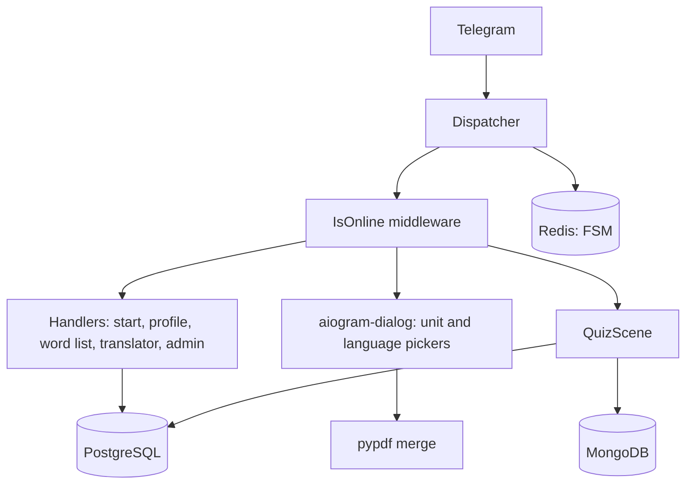

# Essential Words Bot

A Telegram bot for learning English vocabulary, built with aiogram 3. It ran in
production as [@essentialwordstestbot](https://t.me/essentialwordstestbot) with a
three-language interface (English, Russian, Uzbek), a quiz built on native Telegram
polls, a coin-based rating, PDF delivery of study units and a referral system.

## What it does

- **Quiz-Test** — multiple-choice questions built from the word tables. Wrong options are
  drawn from the same unit, so the distractors are always plausible. Answers are collected
  through Telegram's native quiz polls with a 30-second timer.
- **Progress and coins** — a user earns coins per correct answer, but only if the new result
  beats the one already stored for that unit, so the rating rewards improvement rather than
  repetition. Per-unit balances live in MongoDB, the total in PostgreSQL.
- **Top 10** — a live rating; a user who gets overtaken is notified.
- **Word list** — the vocabulary of any unit, English next to the user's own language.
- **PDF units** — pick any set of units and the bot merges them into a single PDF.
- **Translator** — Google Cloud Translate, with language detection.
- **Referrals** — deep-link invites that pay the inviter once per new user.
- **Admin side** — broadcasts, a changelog pipeline, and user statistics.

## Stack

| | |
|---|---|
| Bot framework | aiogram 3 (FSM, Scenes, middleware) + aiogram-dialog |
| Storage | PostgreSQL (users, words, posts), MongoDB (per-unit balances), Redis (FSM state) |
| Services | Google Cloud Translate |
| Other | pydantic-settings, pypdf, Docker Compose |

## How it is put together



Three ways of driving a conversation are used, each where it fits:

- **Plain handlers with FSM states** for linear flows — language choice, profile, translator.
- **aiogram-dialog** for the screens that need many toggles at once: picking units is a
  30-button multiselect with language radios, redrawn in place on every click.
- **An aiogram Scene** for the quiz, because a quiz is a loop over one state: the scene
  re-enters itself on every answer (`wizard.retake`) and runs the scoring on exit, so the
  same code path handles finishing by running out of questions and finishing by pressing Stop.

The quiz keeps its questions in FSM storage rather than in process memory, which is what
lets a restart or two parallel sessions not interfere with each other.

## Running it

```bash
cp .env.example .env     # fill in BOT_TOKEN, passwords, ADMIN_ID, ADMIN_GROUP
docker compose up --build
```

`db/schema.sql` and `db/seed_demo.sql` are applied automatically on the first start, so
the quiz and the word list work out of the box on the demo vocabulary.

Without Docker:

```bash
python -m venv .venv && source .venv/bin/activate
pip install -r requirements.txt
psql -d essential -f db/schema.sql -f db/seed_demo.sql
python main.py
```

`ADMIN_GROUP` is a Telegram group the bot is a member of. The changelog pipeline keeps
message ids rather than text: an admin posts the three language versions of a release note
into that group, and the bot copies the right one to each user, so formatting and media
survive untouched.

## Layout

```
main.py              entry point: logging, dispatcher, router registration
config_reader.py     settings from .env through pydantic
data_small.py        button labels and language maps for the three locales
handlers/            commands and FSM-driven flows
dialogs/             aiogram-dialog windows and the quiz scene
Funcs/, Poll/        entry points into the unit pickers
keyboards/           reply and inline keyboard builders
lg_messages/         language resolution and the cached lookup behind it
middlewares/         last-seen tracking
tools/               database connections, PDF merging, Mongo queries, time helpers
db/                  schema and demo data
```

## A note on content

The bot was built around a commercial vocabulary series, and that material is not part of
this repository: `data/book_units/` is gitignored and `db/seed_demo.sql` carries twenty
demo words instead. The code is the point here — add your own word tables and PDFs and
everything works the same.

## License

MIT, see [LICENSE](LICENSE).
