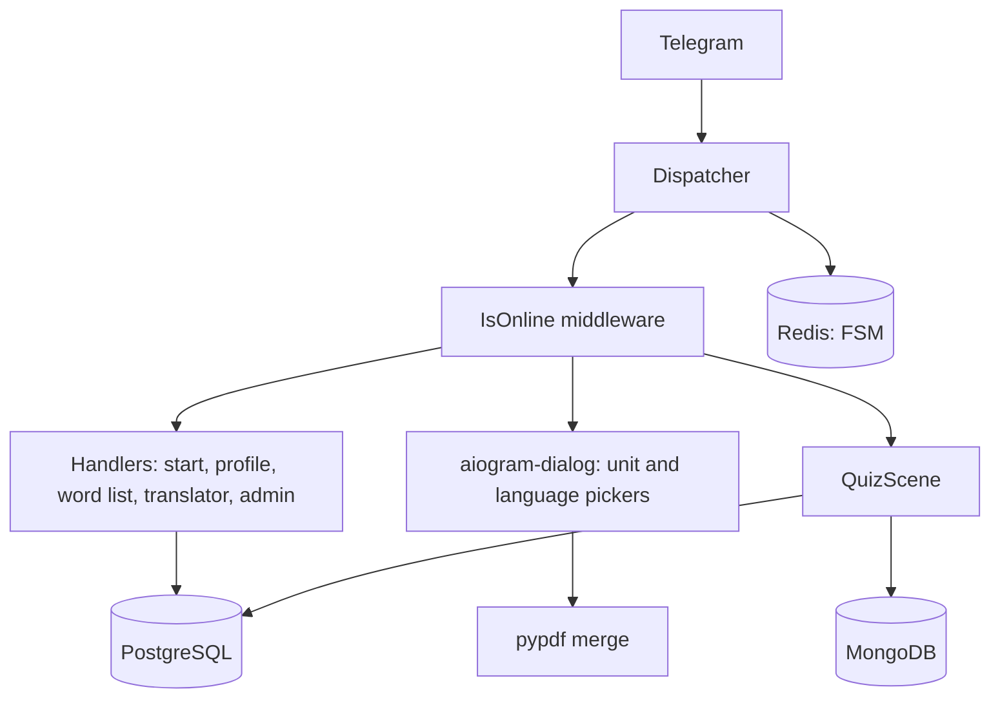

# Essential Words Bot

A Telegram bot for learning English vocabulary, built with aiogram 3. Written in 2024 and
running as [@essentialwordstestbot](https://t.me/essentialwordstestbot): a three-language
interface (English, Russian, Uzbek), a quiz built on native Telegram polls, a coin-based
rating, PDF delivery of study units and a referral system.

This repository is the cleaned-up public version of it — credentials moved out of the code,
the duplicated parts collapsed, and the schema and setup written down so it can actually be
run by someone else. `db/migrations/` has what it takes to bring a database created by the
first version up to the current schema.

## What it does

- **Quiz-Test** — multiple-choice questions built from the word tables. Wrong options are
  drawn from the same unit, so the distractors are always plausible. Answers are collected
  through Telegram's native quiz polls with a 30-second timer.
- **Progress and coins** — a user earns coins per correct answer, but only if the new result
  beats the one already stored for that unit, so the rating rewards improvement rather than
  repetition. Per-unit balances live in MongoDB, the total in PostgreSQL.
- **Top 10** — a live rating; a user who gets overtaken is notified.
- **Word list** — the vocabulary of any unit, English next to the user's own language.
- **PDF units** — pick any set of units and the bot merges them into a single PDF.
- **Translator** — Google Cloud Translate, with language detection.
- **Referrals** — deep-link invites that pay the inviter once per new user.
- **Admin side** — broadcasts, a changelog pipeline, and user statistics.

## Stack

| | |
|---|---|
| Bot framework | aiogram 3 (FSM, Scenes, middleware) + aiogram-dialog |
| Storage | PostgreSQL (users, words, posts), MongoDB (per-unit balances), Redis (FSM state) |
| Services | Google Cloud Translate |
| Other | pydantic-settings, pypdf, Docker Compose |

## How it is put together



Three ways of driving a conversation are used, each where it fits:

- **Plain handlers with FSM states** for linear flows — language choice, profile, translator.
- **aiogram-dialog** for the screens that need many toggles at once: picking units is a
  30-button multiselect with language radios, redrawn in place on every click.
- **An aiogram Scene** for the quiz, because a quiz is a loop over one state: the scene
  re-enters itself on every answer (`wizard.retake`) and runs the scoring on exit, so the
  same code path handles finishing by running out of questions and finishing by pressing Stop.

The quiz keeps its questions in FSM storage rather than in process memory, which is what
lets a restart or two parallel sessions not interfere with each other.

## Running it

You need a bot token from [@BotFather](https://t.me/BotFather), a Telegram group for the
bot to keep its posts in, and the four required values in `.env`. Everything else has a
working default — see `.env.example`.

```bash
cp .env.example .env     # BOT_TOKEN, DB_PASSWORD, ADMIN_ID, ADMIN_GROUP
docker compose up --build
```

`db/schema.sql` and `db/seed_demo.sql` are applied on the first start, so the quiz and the
word list work out of the box on the demo vocabulary.

Without Docker you need PostgreSQL, MongoDB and Redis running locally:

```bash
python -m venv .venv && source .venv/bin/activate
pip install -r requirements.txt
createdb essential
psql -d essential -f db/schema.sql -f db/seed_demo.sql
python main.py
```

The translator is the only part that needs something external — a Google Cloud project
with the Translation API and a service-account key. Leave `GOOGLE_PROJECT` empty and the
bot tells the user that the translator is not configured instead of failing.

PDF delivery expects the unit files under `data/book_units/` as `{lang}_{book}_{unit}.pdf`,
and whole books by their Telegram `file_id` in `data_small.py`. Neither is in the
repository (see the note below); the rest of the bot works without them.

### How the changelog pipeline works

The bot does not store post text. An admin sends `/update 1.3` in the admin group followed
by three messages — English, Russian, Uzbek — and the bot saves their `message_id`s. On
`/send` it copies the matching one to every user, so formatting, media and buttons survive
untouched. `/about_update` and `/newsletter` work the same way against their own tables.

## Tests

```bash
pip install -r requirements-dev.txt
pytest
```

The handlers are driven through the real `Dispatcher` with a mocked Bot API session
(`tests/mocked.py`), which answers calls locally and records them. So a test feeds an
`Update` the way Telegram would and then asserts on what the bot tried to send — the
quiz tests play a whole round: receive the poll, answer it, press Stop, and check the
score and the coins that ended up in the database.

The suite talks to real PostgreSQL and MongoDB, using ids outside the Telegram range and
cleaning up after itself. Mongo is cleaned too, not just Postgres: the per-unit balances
decide whether a quiz pays out, so a leftover document changes what the next test earns.

## Layout

```
main.py              entry point: logging, dispatcher, router registration
config_reader.py     settings from .env through pydantic
data_small.py        button labels and language maps for the three locales
handlers/            commands and FSM-driven flows
dialogs/             aiogram-dialog windows and the quiz scene
Funcs/, Poll/        entry points into the unit pickers
keyboards/           reply and inline keyboard builders
lg_messages/         language resolution and the cached lookup behind it
middlewares/         last-seen tracking
tools/               database connections, PDF merging, Mongo queries, time helpers
db/                  schema, migrations and demo data
tests/               handler and quiz tests against a mocked Bot API
```

## A note on the content

The bot was built around a commercial vocabulary series, and that material is not part of
this repository: `data/book_units/` is gitignored and `db/seed_demo.sql` carries twenty
demo words instead. The code is the point here — add your own word tables and PDFs and
everything works the same.

## License

MIT, see [LICENSE](LICENSE).
